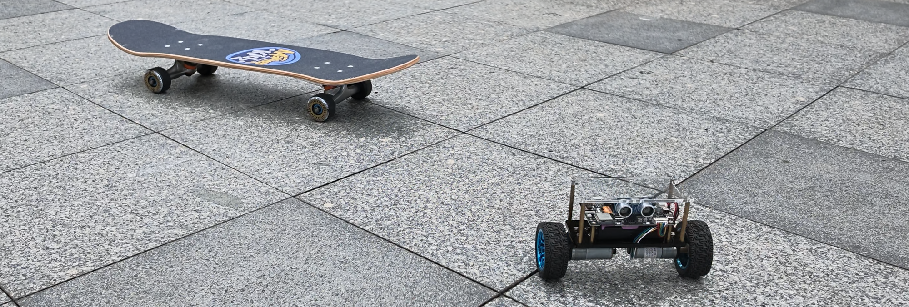
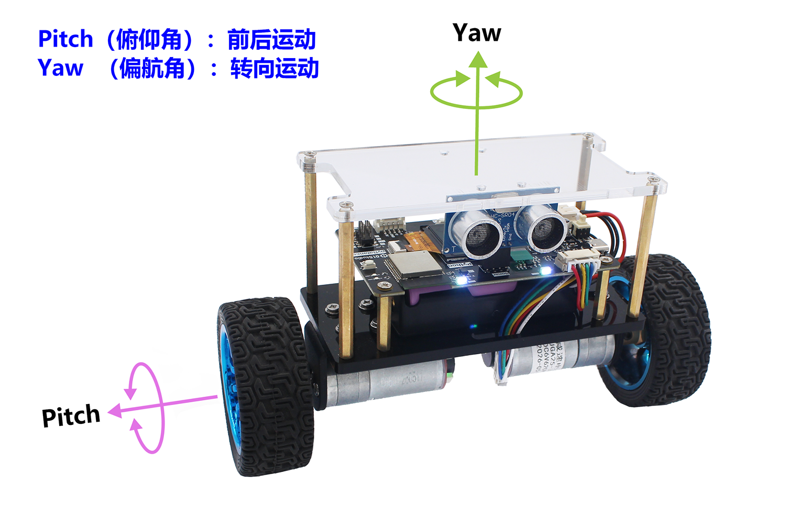
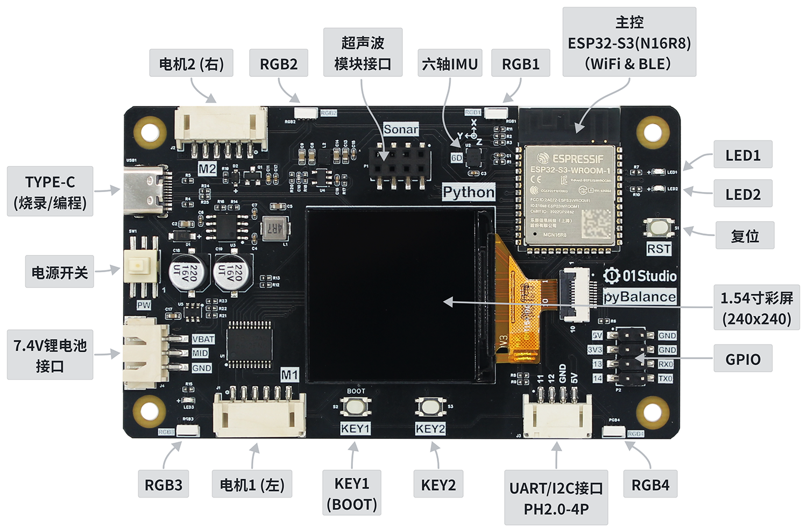
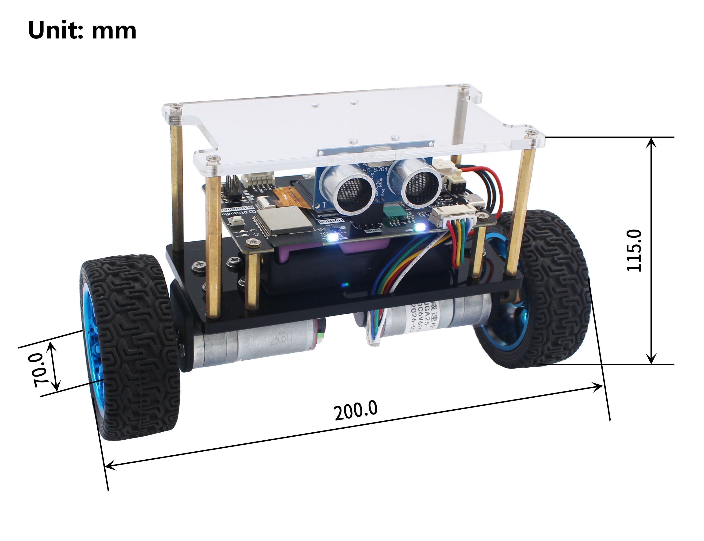

# pyBalance

[English](README.md) | **中文**



## 项目简介
Micropython是指使用Python做各类嵌入式硬件设备编程。MicroPython发展势头强劲，01Studio一直致力于Python嵌入式编程，特此推出pyDrone开源项目，旨在让MicroPython变得更加流行。使用MicroPython，你可以轻松地实现平衡小车直立、前进、后退、巡线、超声波避障、WiFi蓝牙遥控等功能。



例：
```python
import pyBalance

#构建平衡小车对象
b = pyBalance.BALANCE() 

#使用方法

#启动
b.start()

#运动速度
b.speed(valnue = 4)

#姿态动作控制
d.control(pit = 0, yaw = 0)

#停止
b.stop()

...
```
## 硬件资源

pyBalance [点击购买>>](https://item.taobao.com/item.htm?id=1080394969733)



|  产品参数 |  |
|  :---:  | ---  |
| 主控  | ESP32-S3-WROOM-1 （N16R8，Flash:16MBytes，RAM:8MBytes）; 支持WiFi/BLE |
| LED  | x3 <br></br> ● 电源指示灯：红色 <br></br>  ● 可编程LED1：蓝色 <br></br> ● 可编程LED2：绿色 |
| 按键  | x3 <br></br> ● 复位键 <br></br>  ● 可编程 KEY1 <br></br> ● 可编程 KEY2 |
| RGB彩灯  | x4 <br></br>  ● WS2812B/串联 |
| 六轴IMU  | QMI8658A (三轴加速度 + 三轴陀螺仪) |
| 显示屏  | ● 1.54寸彩屏 <br></br> ● 分辨率 240x240 <br></br> ● 驱动IC：ST7789 |
| GPIO  | 2.54mm x 8P 排针 |
| 串口/I2C接口  | PH-2.0mm-4P（送转接线） |
| MicroUSB口  | 烧录/调试 多合一 |
| 电机  | x2  <br></br>  ● 直流减速电机 (带编码器) <br></br>  ● 电压: 6V  <br></br>  ● 转速: 620 r/min  <br></br>  ● 减速比 1:9.2|
| 轮胎  | ● 直径: 70mm  <br></br> ● 宽度: 27mm |
| 锂电池  | 7.4V / 两节18650锂电池串联（单节容量2200mAh）/ XH-2.54mm-3P接口 |
| 机身  | 亚克力机身 + 铝合金电机支架 |

|  外观规格 | |
|  :---:  | ---  |
| 尺寸  | 200 x 70 x 115mm（长宽高 / 整机） |
| 重量  | 560克（含电池 / 整机） |



## 目录结构

```
pyBalance/
├── examples/          # 示例代码
├── hardware/          # 硬件设计资料（原理图、封装、3D 模型）
├── firmware/          # 固件
├── app/               # Android APP
├── CHANGELOG.md       # 更新日志
├── LICENSE
├── README.md          # 英文说明
└── README_zh.md       # 中文说明
```

## 开发资源

- [Wiki（教程文档）](https://wiki.01studio.cc/docs/pybalance)
- [ESP32在线烧录](https://flash.01studio.cc)

## 更新日志

请参阅 [CHANGELOG.md](CHANGELOG.md)。

## 技术支持

遇到问题可通过以下方式获取支持：

**邮件联系**：发送邮件至 [support@01studio.cc](mailto:support@01studio.cc)。     